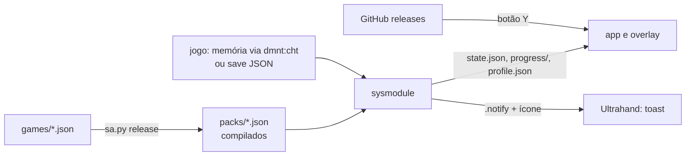

# Switch Achievements

Conquistas nativas para Nintendo Switch com Atmosphère. Tudo roda no console:

- **Sysmodule** (`sysmodule/`): liga com o console, detecta o jogo aberto e a versão dele, lê a memória do jogo pelo `dmnt:cht` do Atmosphère (ou o save, nos ports homebrew), avalia as conquistas e dispara a notificação com ícone e som.
- **App Conquistas** (`app/`): biblioteca no estilo da tela inicial, com os jogos e, dentro de cada um, as conquistas concluídas e bloqueadas. O botão **Y** baixa a última versão do GitHub (app, sysmodule, overlay, jogos e ícones).
- **Overlay** (`overlay/`): a mesma lista dentro do menu do Ultrahand, para ver sem sair do jogo.

Cada jogo é descrito por **um JSON** (`games/<id>.json`): conteúdo, variáveis, endereços por versão e conquistas. Não há código por jogo.

## Instalar no console

1. Baixe `switch-achievements-sd.zip` da [última release](https://github.com/iiiiiuri/nx-trophies/releases/latest).
2. Extraia na raiz do cartão SD (junta com as pastas `atmosphere/`, `switch/` e `config/` que já existem).
3. Reinicie o console. O sysmodule começa a rodar sozinho.
4. Abra **Conquistas** pelo Homebrew Menu.

Requisitos: Atmosphère e Ultrahand Overlay ≥ 2.3 (é ele que mostra as notificações por cima do jogo).

Depois disso, atualize pelo próprio app (botão **Y**). O progresso fica em `sdmc:/config/switch-achievements/state.json` e nunca é apagado por atualização.

O som da conquista substitui o som **global** de notificação do Ultrahand. O original fica em `sdmc:/config/switch-achievements/backup/ultrahand-notification.wav`.

## Jogos

| Jogo | Versões | Conquistas | Ativas / ensaio |
|---|---|---|---|
| [Link's Awakening](games/zelda_links_awakening.json) | todas (1.0.0, 1.0.1, 1.1.0) | 49 | 48 / 1 |
| [Mario Kart 8 Deluxe](games/mario_kart_8_deluxe.json) | 3.0.5 e 2.4.0 a 3.0.3 | 35 | 6 / 1 |
| | 2.0.0 | 35 | 5 / 2 |
| | 4.0.0 e 4.0.1 | 35 | 0 / 4 |
| [Ship of Harkinian (OoT)](games/ship_of_harkinian.json) | save JSON ([detalhes](docs/jogos/ship-of-harkinian.md)) | 34 | 34 / 0 |

Os endereços vêm de cheats e mapas de memória públicos; as fontes de cada um estão em [`research/enderecos.md`](research/enderecos.md). "Ensaio" são conquistas com endereço presumido: o sysmodule avalia e anota em `sysmodule.log`, mas só desbloqueia depois de confirmado no console. As demais conquistas do Mario Kart (troféus por copa, vitórias e moedas na 3.0.5) ainda não têm endereço e aparecem como "ainda não rastreada". Uma versão de jogo sem nada mapeado aparece no app como "sem suporte", com o build ID detectado.

## Adicionar um jogo

Adicione `games/<id>.json` na estrutura padrão; o catálogo o descobre sozinho e a suíte de testes o valida. Ícones vão em `assets/icons/<id>/`. Publicar uma tag `v*` gera a release, e o app de todo mundo recebe o jogo novo no próximo **Y**.

```bash
python3 tools/sa.py new super_mario_odyssey --name "Super Mario Odyssey" --title-id 0100000000010000 --build-id <BUILD_ID>
python3 tools/sa.py validate
```

Guia completo: [`docs/adicionar-um-jogo.md`](docs/adicionar-um-jogo.md). Estrutura: [`docs/modelo-de-definicao.md`](docs/modelo-de-definicao.md).

## Como funciona



O Python em `tools/` é a referência da semântica. `sa.py release` compila cada definição num pacote enxuto (templates expandidos, variáveis indexadas, blocos de leitura por versão), e o motor C++ em `native/common/` só executa. Os testes rodam o motor C++ no PC e comparam com o Python tick a tick.

## Desenvolvimento

```bash
python3 -m unittest discover -s tools/tests -t tools/tests     # inclui paridade C++ x Python (precisa de g++)

# compilar (Docker com devkitPro)
for dir in overlay sysmodule app; do
  docker run --rm -u $(id -u):$(id -g) -v "$PWD":/src -w /src/$dir devkitpro/devkita64:latest make -j8
done

python3 tools/sa.py build                    # dist/sd/, a árvore do cartão
python3 tools/sa.py release --version 1.2.3  # dist/release/: zip + manifest.json
```

O CI (`.github/workflows/release.yml`) faz o mesmo a cada push; numa tag `v*` ele publica a release que o app baixa.

Pela rede local, com FTP no console e `device.local.json` preenchido (veja `device.local.json.example`):

```bash
python3 tools/sa.py device install   # envia dist/sd/ para o SD
python3 tools/sa.py device probe     # confere o SD
```

Ferramentas de análise no PC: `list`, `detect`, `index`, `replay` (traces de memória simulada) e `save` (saves do SoH).

## Estrutura

| No repositório | Para quê |
| --- | --- |
| `games/<id>.json` | definição de cada jogo |
| `assets/icons/<id>/<conquista ou template>.png` | ícones; sem ícone, usa `assets/icons/common/trophy.png` |
| `assets/covers/<id>.png` | capa no app quando o jogo não tem ícone do sistema (homebrew) |
| `assets/sounds/achievement.wav` | som da conquista (PCM 16 bits, 48 kHz) |
| `native/common/` | motor C++ compartilhado (pacote, expressões, motor, visões) |
| `sysmodule/`, `app/`, `overlay/` | os três binários do console |
| `tools/` | CLI, avaliador de referência e compilador de pacotes; caminhos do SD em `tools/sa_core/layout.py` |

| No SD | Quem escreve |
| --- | --- |
| `atmosphere/contents/4200000000534143/` | release (sysmodule, inicia no boot) |
| `switch/switch-achievements/switch-achievements.nro` | release (app) |
| `switch/.overlays/switch-achievements.ovl` | release (overlay) |
| `config/switch-achievements/packs/`, `icons/`, `covers/`, `sounds/`, `version.json` | release |
| `config/switch-achievements/state.json`, `profile.json`, `progress/<jogo>.json`, `detected.json`, `sysmodule.log` | sysmodule |
| `config/ultrahand/assets/notifications/SwitchAchievements-*.rgba` | release |
| `config/ultrahand/sounds/notification.wav` | release (original em `backup/`) |
