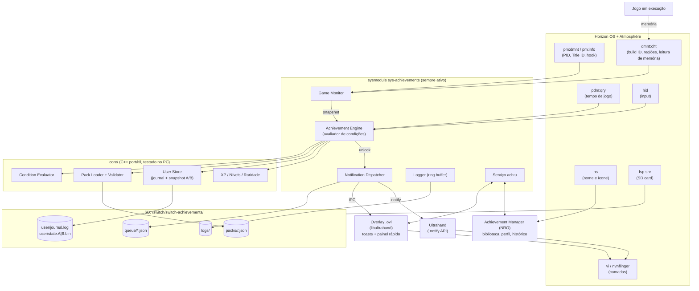
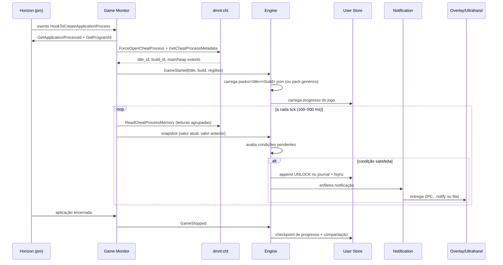

# Switch Achievements — Estudo de Viabilidade Técnica

> Versão 0.1 · Novembro/2026 · Status: proposta, antes de qualquer implementação
>
> **Atualização:** os "packs" por título/build descritos aqui foram substituídos por uma definição única por jogo (`games/<id>.json`), com bindings por build. Veja [modelo-de-definicao.md](modelo-de-definicao.md).

Este documento avalia se é possível construir um sistema de conquistas universal para Nintendo Switch com CFW (Atmosphère), com notificações sobrepostas aos jogos, e define arquitetura, riscos e um MVP realista.

**Conclusão curta:** é viável, desde que o projeto aceite três restrições estruturais:

1. **Não existe API de "eventos do jogo".** Toda conquista específica de jogo depende de leitura de memória (via `dmnt:cht` do Atmosphère), e os endereços precisam ser descobertos por engenharia reversa **por jogo e por versão** (build ID).
2. **O overlay não é um processo independente.** Overlays libtesla rodam dentro do `nx-ovlloader`, e apenas um overlay fica carregado por vez. O motor de conquistas tem que ser um **sysmodule separado**, e as notificações precisam de um caminho que funcione mesmo quando o nosso overlay não está carregado.
3. **O orçamento de memória do sysmodule é minúsculo.** Os sysmodules disputam o pool de memória de sistema com o próprio Horizon e com outros homebrews. O motor deve caber em poucas centenas de KB de heap.

---

## Sumário

1. [Respostas à investigação técnica obrigatória](#1-respostas-à-investigação-técnica-obrigatória)
2. [Classificação das capacidades](#2-classificação-das-capacidades)
3. [Arquitetura recomendada](#3-arquitetura-recomendada)
4. [Diagrama de componentes](#4-diagrama-de-componentes)
5. [Fluxo de funcionamento](#5-fluxo-de-funcionamento)
6. [Tecnologias e bibliotecas](#6-tecnologias-e-bibliotecas)
7. [Formato declarativo de conquistas](#7-formato-declarativo-de-conquistas)
8. [Persistência](#8-persistência)
9. [Limitações técnicas identificadas](#9-limitações-técnicas-identificadas)
10. [Riscos de desenvolvimento](#10-riscos-de-desenvolvimento)
11. [Complexidade por componente](#11-complexidade-por-componente)
12. [Plano de implementação por etapas](#12-plano-de-implementação-por-etapas)
13. [Estrutura inicial de diretórios](#13-estrutura-inicial-de-diretórios)
14. [Definição do MVP](#14-definição-do-mvp)
15. [Referências](#15-referências)

---

## 1. Respostas à investigação técnica obrigatória

### 1.1 Quais recursos o Switch desbloqueado oferece ao homebrew?

Com Atmosphère, o homebrew tem acesso a praticamente todos os serviços IPC do Horizon OS, limitado pelas permissões declaradas no NPDM (o manifesto de capacidades do executável). Existem três formas de execução relevantes:

| Forma | O que é | Quando roda | Uso no projeto |
|---|---|---|---|
| **Aplicação NRO** (hbmenu) | App de tela cheia lançado pelo Homebrew Menu, em modo applet ou "title takeover" | Só quando o jogo **não** está em primeiro plano | Achievement Manager completo (biblioteca, perfil, histórico) |
| **Sysmodule** (`/atmosphere/contents/<program_id>/exefs.nsp` + `flags/boot2.flag`) | Processo de sistema em segundo plano, inicializado no boot | Sempre, inclusive durante o jogo | Achievement Engine + Game Monitor |
| **Overlay `.ovl`** (Tesla Menu / Ultrahand) | NRO carregado pelo sysmodule `nx-ovlloader`, desenhado numa camada VI acima do jogo | Sob demanda, por combinação de botões | Overlay Interface (painel rápido + toasts) |

Bibliotecas e APIs disponíveis: `libnx` (wrappers de serviços e SVCs), `libstratosphere` (framework C++ dos sysmodules do Atmosphère), `libtesla`/`libultrahand` (UI de overlay), `deko3d` (GPU de baixo nível) e os portlibs do devkitPro (zlib, libpng, freetype, SDL2, entre outros).

### 1.2 É possível manter um overlay ativo durante a execução de jogos?

**Sim, com ressalvas.** O `nx-ovlloader` cria uma camada gerenciada (`viCreateManagedLayer` + `viSetLayerZ`) sobre o jogo, e a libtesla desenha nela um framebuffer de **448×720 RGBA4444 com buffer duplo** (`tesla.hpp`, linhas 1033–1065). O jogo continua rodando por baixo, sem suspensão.

Ressalvas:

- **Um overlay por vez.** Ao abrir outro overlay pelo menu, o nosso é descarregado.
- **Input:** quando o overlay está em foco, a libtesla chama `hidsysEnableAppletToGetInput(false)` (`requestForeground`), e o jogo para de receber input. Uma notificação *não pode* pegar o foco, ou o jogador perde o controle por alguns segundos.
- **Largura fixa:** a camada padrão é uma faixa lateral de 448 px. Toasts horizontais exigem layout customizado (o Ultrahand já faz isso para as notificações dele).

### 1.3 Quais são as limitações do Tesla Menu e da libtesla?

- **Heap do overlay:** configurável no Ultrahand em 4, 6 ou 8 MB. Wallpaper exige 6 MB ou mais, e o número de slots de notificação cai para 4 com 4 MB.
- **Renderização por software** em RGBA4444. É suficiente para texto, ícones pequenos e animações simples de deslizar e fade, mas não serve para efeitos elaborados.
- **Ciclo de vida:** o overlay é carregado e descarregado pelo menu. Não é um lugar confiável para lógica de longa duração.
- **Projeto original parado:** o Tesla Menu e a libtesla do WerWolv tiveram pouca evolução. O **Ultrahand Overlay / libultrahand** (ppkantorski) é o sucessor ativo, compatível com os `.ovl` existentes, e traz um sistema de notificações toast.
- **Sem captura de tela nem acesso ao framebuffer do jogo:** o overlay só desenha por cima.

### 1.4 É possível identificar automaticamente o jogo em execução?

**Sim, de forma confiável.**

- `pmdmntGetApplicationProcessId(&pid)` seguido de `pmdmntGetProgramId(&tid, pid)` (ou `pminfoGetProgramId`) retorna o Title ID da aplicação em primeiro plano.
- `pmdmntHookToCreateApplicationProcess(&event)` gera um evento quando uma aplicação é criada, o que evita polling.
- `dmntchtGetCheatProcessMetadata` retorna `title_id`, **`main_nso_build_id`** (identifica a versão exata do executável) e as extensões das regiões `main`, `heap`, `alias` e `address_space`. Isso é essencial, porque endereços mudam entre versões.
- `nsGetApplicationControlData` retorna o nome localizado e o ícone JPEG 256×256 do jogo, usados na biblioteca.

### 1.5 É possível monitorar a memória de outros processos?

**Sim, via engenharia reversa por jogo.** Existem duas rotas:

| Rota | Como funciona | Prós | Contras |
|---|---|---|---|
| **`dmnt:cht` (recomendada)** | Serviço do Atmosphère que já fica anexado como depurador à aplicação. Expõe `ReadCheatProcessMemory`, `QueryCheatProcessMemory`, `GetCheatProcessMappings` | Não disputa o "slot" de depurador; é a mesma via usada por EdiZon, Breeze e sys-botbase; leitura simples por IPC | Depende do Atmosphère; cada leitura é uma chamada IPC (é preciso agrupar leituras); sujeito a mudanças do Atmosphère |
| `svcDebugActiveProcess` + `svcReadDebugProcessMemory` | Anexar como depurador diretamente | Independente do dmnt | Exige capacidade de debug no NPDM; **um processo só aceita um depurador**, o que gera conflito com dmnt/cheats e com o SaltyNX; risco de pausar o jogo |

Ponto crítico: **ASLR**. Os endereços variam a cada execução. As condições devem ser expressas relativas a uma região (`main+0x…`, `heap+0x…`) e, normalmente, como **cadeias de ponteiros** (`[[main+0x4C8F120]+0x18]+0x2A0`), exatamente como os cheats do Atmosphère e o EdiZon fazem.

### 1.6 Quais permissões, serviços e limitações do Horizon OS estão envolvidos?

| Serviço | Para quê | Observação |
|---|---|---|
| `pm:dmnt` / `pm:info` | PID e Title ID da aplicação, hook de criação de processo | Precisa constar no NPDM do sysmodule |
| `dmnt:cht` | Metadados do processo, build ID e leitura de memória | Exclusivo do Atmosphère |
| `ns:am2` / `ns` | Nome e ícone do jogo (`nsGetApplicationControlData`) | |
| `fsp-srv` | Acesso ao SD (`sdmc:`) | |
| `pdm:qry` | Histórico de tempo de jogo (usado pelo NX-Activity-Log) | Útil para conquistas de "jogue X horas" sem RE |
| `hid` / `hid:sys` | Input (combos, conquistas de input) e controle de foco do overlay | |
| `vi:m` / `vi:s` | Camadas de display | Usado pelo nx-ovlloader |
| `audren:u` / `audout:u` | Efeito sonoro | Opcional |
| `time:s` / `time:u` | Timestamp dos desbloqueios | |
| `set:sys` | Idioma do sistema (localização) | |

Limitações:
- **Sessões IPC e handles são contados por processo**, com limites. É preciso abrir os serviços uma vez e reutilizar.
- **Pool de memória de sistema:** todos os sysmodules dividem uma reserva pequena. Sysmodules "pesados" já causaram falhas de boot e travamentos documentados pela comunidade.
- **Threads:** sysmodules normalmente rodam no core 3, compartilhado com o sistema. Laços ocupados degradam todo o console.

### 1.7 É possível manter um processo auxiliar ativo enquanto o jogo roda?

**Sim. É exatamente o que um sysmodule é.** Exemplos reais que fazem isso durante o jogo: `sys-ftpd`, `sys-con`, `sys-clk`, `sys-tune` (toca música em segundo plano), `sys-botbase`, `nx-ovlloader` e `SaltyNX`. O sysmodule é registrado em `/atmosphere/contents/<program_id>/` com `flags/boot2.flag` para iniciar no boot.

### 1.8 Como persistir dados sem comprometer a estabilidade?

- Gravar **somente no SD** (`sdmc:/switch/switch-achievements/`), nunca em NAND nem em saves de sistema.
- **Gravações raras e pequenas:** um desbloqueio é um evento raro. Progresso contínuo (contadores) fica em RAM e é salvo só em checkpoints: no desbloqueio, a cada N minutos e ao detectar a saída do jogo.
- **Journal append-only + snapshot A/B com CRC32**, detalhado na [seção 8](#8-persistência). Evita corrupção por desligamento abrupto ou remoção do SD, e evita depender de `rename` atômico, que FAT32/exFAT não garantem.
- O SD formatado em exFAT tem histórico de corrupção no Switch. A documentação deve recomendar FAT32.

### 1.9 Como notificar sem derrubar o FPS?

- **O jogo não é tocado.** O compositor (`nvnflinger`) mescla a camada do overlay em hardware. O custo é desenhar o framebuffer do overlay na CPU (448×720×2 bytes ≈ 630 KB por buffer).
- **Desenhar só quando muda:** animar entrada e saída em cerca de 300 ms e manter o quadro estático no meio. Fora da notificação, a camada fica invisível e não há render.
- **Monitoramento barato:** polling de memória de 2 a 10 Hz, com leituras agrupadas (um bloco contíguo por condição, não um byte por vez), e `svcSleepThread` entre ciclos. Nada de espera ativa.
- **Sem bloquear o jogo:** nunca usar `dmntchtPauseCheatProcess` para ler memória.
- **Prioridade baixa** para as threads do sysmodule.

### 1.10 Quais abordagens permitem conquistas específicas por jogo?

Em ordem crescente de custo e risco:

| Nível | Fonte de sinal | Exige RE? | Exemplos de conquista |
|---|---|---|---|
| 0 | **Sistema** (Title ID, `pdm:qry`, relógio) | Não | "Abriu o jogo pela 1ª vez", "Jogou 10 horas", "Jogou de madrugada" |
| 1 | **Input** (`hid`) | Não | "Executou o Konami Code", "Fez 1000 saltos"; frágil e pouco significativo |
| 2 | **Memória** (`dmnt:cht` + pointer chains) | **Sim, por jogo e versão** | "Derrotou o primeiro chefe", "Juntou 100 moedas", "Zerou sem morrer" |
| 3 | **Save data** (leitura do save do jogo, como o JKSV faz) | Sim (formato do save) | Conquistas retroativas ("já zerou antes de instalar") |
| 4 | **Injeção de código** (plugin SaltyNX / hooks) | Sim, profunda | Eventos exatos (hook na função "boss_defeated"); máximo de precisão e de risco |

A plataforma deve suportar os níveis 0, 1 e 2 desde o início, com o nível 2 como principal. O nível 3 entra como importação offline pelo Manager (com o jogo fechado). O nível 4 fica como pesquisa futura.

---

## 2. Classificação das capacidades

| Capacidade | Oficial | Homebrew (padrão) | Permissão especial | Exige RE | Inviável/instável |
|---|:-:|:-:|:-:|:-:|:-:|
| Sistema de conquistas nativo do Switch | ❌ não existe | | | | |
| SDK oficial (NintendoSDK) | Sob NDA, inacessível | | | | |
| Identificar o jogo em execução | | ✅ `pm:dmnt` | NPDM | | |
| Nome e ícone do jogo | | ✅ `ns` | | | |
| Processo em segundo plano durante o jogo | | ✅ sysmodule | `boot2.flag` | | |
| Overlay sobre o jogo | | ✅ nx-ovlloader | `vi` | | |
| Toast sem roubar input | | ✅ Ultrahand / custom | | | |
| Ler memória do jogo | | ✅ `dmnt:cht` | Atmosphère | | |
| Saber **o que** um endereço significa | | | | ✅ por jogo e versão | |
| Tempo de jogo | | ✅ `pdm:qry` | | | |
| Efeito sonoro a partir do overlay | | ✅ `audren`/`audout` | | | ⚠️ coexistência com o áudio do jogo; tratar como opcional |
| Ler save do jogo **com o jogo aberto** | | | | ✅ | ⚠️ o save fica travado e há risco de corromper. Evitar |
| Hooks por injeção de código | | ✅ SaltyNX | | ✅ profunda | ⚠️ quebra entre versões e conflita com outros plugins |
| Universal "sem configurar nada" para todos os jogos | | | | | ❌ não existe forma genérica de saber "derrotou um chefe" |
| Funcionar online sem risco | | | | | ❌ CFW online tem risco de ban, e isso independe do projeto. Recomendar emuMMC offline |
| Escrever na memória do jogo | | ✅ possível | | | 🚫 **fora de escopo por política**: o sistema é somente leitura |

---

## 3. Arquitetura recomendada

### 3.1 Princípios

1. **Motor fora da UI.** O sysmodule é a única fonte da verdade. Overlay e Manager são clientes.
2. **Somente leitura.** O sistema nunca escreve na memória do jogo. Isso reduz risco e evita cheats.
3. **Dados declarativos e versionados.** Conquistas são arquivos JSON por jogo e build ID, validados por um JSON Schema.
4. **Degradação graciosa.** Sem pack para o build atual, o motor só registra tempo de jogo. Se o `dmnt:cht` falha, o monitor de memória é desligado e o resto continua. Se não houver overlay carregado, a notificação vai para a fila.
5. **Núcleo portátil.** O avaliador de condições e a persistência são C++ puro, sem libnx, e por isso testáveis no PC.

### 3.2 Processos e responsabilidades

| Componente | Processo | Responsabilidade |
|---|---|---|
| **Achievement Engine** | sysmodule `sys-achievements` | Carrega packs, avalia condições, aplica regras (contadores, sequências, deltas) e emite desbloqueios |
| **Game Monitor** | sysmodule (thread) | Detecta início e fim da aplicação, resolve Title ID e build ID, abre a sessão `dmnt:cht`, resolve regiões e pointer chains e entrega *snapshots* de memória ao Engine |
| **Achievement Database** | biblioteca compartilhada (`core/`) | Packs JSON (somente leitura) + estado do usuário (journal + snapshot) |
| **Notification System** | sysmodule (produtor) + overlay (consumidor) | Fila persistente de notificações e despacho para o *backend* disponível |
| **Overlay Interface** | `.ovl` (libultrahand/libtesla) | Toasts de desbloqueio e painel rápido: progresso do jogo atual, últimas conquistas |
| **Achievement Manager** | app NRO | Biblioteca, perfil, XP e níveis, histórico, conquistas secretas, configurações, validação de packs |

### 3.3 Estratégia de notificação (ponto mais delicado)

Como só um overlay fica carregado por vez, o Notification System tem *backends* escolhidos em tempo de execução, nesta ordem:

1. **Overlay próprio carregado** (`switch-achievements.ovl`): toast com a identidade visual do projeto, recebido via IPC do sysmodule. É a melhor experiência.
2. **Ultrahand presente:** o sysmodule grava `sdmc:/config/ultrahand/notifications/<APP_ID>-<seq>.notify` (JSON com `title`, `text`, `duration`), com ícone 50×50 RGBA em `/config/ultrahand/assets/notifications/<APP_ID>.rgba`. **Esta API é documentada e verificada** (Ultrahand ≥ 2.1, ampliada na 2.3). É o caminho mais robusto para o MVP.
3. **Nenhum dos dois:** a notificação fica na fila persistente e aparece na próxima abertura do overlay ou do Manager. O desbloqueio nunca se perde.
4. **(Pesquisa, fase posterior)** Camada VI própria criada pelo sysmodule, para não depender de nenhum menu de overlay. É tecnicamente plausível, já que o nx-ovlloader faz exatamente isso, mas custa cerca de 1 MB de framebuffer no pool de sistema e pode conflitar com o Z-order do Tesla/Ultrahand. Só deve entrar depois de medições.

### 3.4 IPC entre processos

- **Recomendado:** o sysmodule expõe um serviço próprio (`ach:u`) com `libstratosphere` ou com um servidor IPC mínimo sobre libnx. Comandos: `GetCurrentGame`, `GetGameProgress`, `PopNotification`, `GetNotificationEvent`, `ReloadPacks`.
- **Fallback do MVP:** comunicação por arquivos no SD (fila em diretório + `status.json`). É mais simples de depurar e suficiente para a frequência de eventos de conquistas.

---

## 4. Diagrama de componentes



---

## 5. Fluxo de funcionamento

### 5.1 Ciclo de vida de uma sessão de jogo



### 5.2 Ciclo de avaliação (Engine)

1. Recebe o snapshot do tick: para cada *memref* do pack, o valor atual e o anterior.
2. Para cada conquista **ainda bloqueada e ativa**:
   - avalia o grupo `requires` (AND), os grupos `alt` (OR) e o grupo `reset_if`;
   - atualiza `hit counts` e contadores de progresso;
   - se satisfeita durante `confirm_frames` ticks consecutivos (anti-falso-positivo), dispara o desbloqueio.
3. Conquistas desbloqueadas saem do conjunto ativo, então o custo cai com o tempo.
4. **Guardas de sanidade:** se um ponteiro resolve fora das regiões conhecidas ou a leitura falha N vezes, a conquista vai para o estado `suspended` e o motivo vai para o log. Nunca desbloqueia "por acidente".
5. **Proteção de carregamento:** muitos jogos zeram ou movem estruturas em telas de loading. A regra `active_when` (ex.: "ponteiro do jogador ≠ 0") desativa a avaliação nesses momentos.

---

## 6. Tecnologias e bibliotecas

| Área | Escolha | Motivo |
|---|---|---|
| Toolchain | **devkitPro / devkitA64** (`switch-dev`) | Padrão de fato do homebrew de Switch |
| Linguagem | **C++20** (sem exceções e sem RTTI no sysmodule) | Controle de memória; exceções e RTTI aumentam o binário |
| Sysmodule | **libnx** (MVP) → `libstratosphere` se o IPC próprio crescer | libnx é mais simples; libstratosphere oferece IPC robusto, mas tem curva maior |
| Overlay | **libultrahand** (compatível com libtesla) | Ativo, com notificações e a mesma API do `tsl::` |
| Manager | libnx + **SDL2** (portlib) ou **Borealis** | SDL2 é leve e direto; Borealis dá UI no estilo do sistema |
| JSON | **cJSON** ou **jsmn** no sysmodule; nlohmann/json só no Manager e nas ferramentas de PC | jsmn não aloca, o que é ideal para o pool de sistema |
| Packs em runtime | JSON **compilado** para binário compacto (`.achb`) pela ferramenta de PC, e o sysmodule lê o binário | Evita parsear JSON grande no pool de sistema |
| Estado do usuário | Journal append-only + snapshot binário com CRC32 | Robusto a quedas de energia em FAT |
| Testes | **Catch2** ou **doctest** no host (Linux/macOS/Windows) para `core/`; testes de integração no console via log | O núcleo não depende de libnx |
| Ferramentas | Python (`tools/`): validador de schema, compilador de packs, conversor de cheats do Atmosphère / pointer chains do EdiZon | Facilita a contribuição de packs |
| Engenharia reversa | **Breeze/EdiZon-SE** (busca de memória no console), `nxdumptool` (dump do NSO), Ghidra + loader de NSO/NRO, **sys-botbase** (peek remoto) | Fluxo de descoberta de endereços e pointer chains |
| CI | GitHub Actions com a imagem `devkitpro/devkita64` | Build reprodutível |

---

## 7. Formato declarativo de conquistas

### 7.1 Decisões

- **Um pack por jogo**, com seções por *build ID*. Memória é específica da versão; os metadados (nome, ícone, XP) não são.
- **Memrefs nomeados** em vez de endereços repetidos. Uma conquista referencia `"coins"`, não `main+0x…`, então atualizar uma versão do jogo significa trocar só os endereços.
- **Linguagem de condições inspirada no rcheevos** (RetroAchievements), que é um modelo testado em escala: comparações, *delta* (valor anterior), *hit counts*, *reset_if*, grupos alternativos e *measured* (progresso).
- **Sem código arbitrário** (sem Lua ou scripts) na v1: não há risco de travar o sysmodule, e o custo é previsível.
- **`schema_version`** obrigatório, para migrações futuras.

### 7.2 Exemplo de pack

```json
{
  "schema_version": 1,
  "game": {
    "title_id": "0100000000010000",
    "name": "Exemplo: Jogo de Plataforma",
    "pack_version": "1.2.0",
    "authors": ["comunidade"]
  },

  "builds": {
    "B3E2C1D0A9F8E7D6": {
      "label": "v1.3.0",
      "memrefs": {
        "player_ptr": { "base": "main", "chain": ["0x4C8F120", "0x18"], "type": "u64" },
        "coins":      { "base": "main", "chain": ["0x4C8F120", "0x18", "0x2A0"], "type": "u32" },
        "bosses":     { "base": "main", "chain": ["0x4C8F120", "0x40", "0x10"],  "type": "u8"  },
        "deaths":     { "base": "heap", "offset": "0x1A2B340", "type": "u16" }
      },
      "active_when": { "memref": "player_ptr", "op": "!=", "value": 0 }
    }
  },

  "achievements": [
    {
      "id": "first_boss",
      "name": { "pt-BR": "Primeiro Desafio", "en": "First Challenge" },
      "description": { "pt-BR": "Derrote seu primeiro chefe.", "en": "Defeat your first boss." },
      "icon": "icons/first_boss.png",
      "xp": 100,
      "rarity": "common",
      "secret": false,
      "condition": {
        "requires": [
          { "memref": "bosses", "op": ">=", "value": 1 },
          { "memref": "bosses", "op": ">",  "compare": "delta" }
        ],
        "confirm_ticks": 2
      }
    },
    {
      "id": "coin_hoarder",
      "name": { "pt-BR": "Acumulador", "en": "Hoarder" },
      "description": { "pt-BR": "Junte 999 moedas.", "en": "Collect 999 coins." },
      "xp": 50,
      "rarity": "uncommon",
      "progress": { "memref": "coins", "target": 999 },
      "condition": { "requires": [{ "memref": "coins", "op": ">=", "value": 999 }] }
    },
    {
      "id": "flawless",
      "name": { "pt-BR": "Intocável", "en": "Untouchable" },
      "description": { "pt-BR": "???", "en": "???" },
      "reveal_description": { "pt-BR": "Derrote 3 chefes sem morrer.", "en": "Defeat 3 bosses without dying." },
      "xp": 500,
      "rarity": "legendary",
      "secret": true,
      "condition": {
        "requires": [
          { "memref": "bosses", "op": ">", "compare": "delta", "hits": 3 }
        ],
        "reset_if": [
          { "memref": "deaths", "op": ">", "compare": "delta" }
        ]
      }
    },
    {
      "id": "ten_hours",
      "name": { "pt-BR": "Dedicação", "en": "Dedication" },
      "description": { "pt-BR": "Jogue por 10 horas.", "en": "Play for 10 hours." },
      "xp": 75,
      "rarity": "common",
      "source": "system",
      "condition": { "requires": [{ "system": "playtime_minutes", "op": ">=", "value": 600 }] }
    }
  ]
}
```

### 7.3 Tipos de fonte suportados (`source`)

| `source` | Dados | Fase |
|---|---|---|
| `system` | `launch_count`, `playtime_minutes`, `local_hour`, `session_minutes` | MVP |
| `memory` (padrão) | memrefs via `dmnt:cht` | MVP |
| `input` | sequências de botões e contadores de input | Fase 3 |
| `save` | campos do save lidos offline pelo Manager | Fase 4 |
| `save_json` | save legível (JSON) observado por mtime durante o jogo; para ports e homebrews como o Ship of Harkinian | **Piloto** ([docs/jogos/ship-of-harkinian.md](jogos/ship-of-harkinian.md)) |
| `meta` | "desbloqueie todas as outras do jogo" (platina) | Fase 2 |

### 7.4 Operadores e modificadores

- `op`: `==`, `!=`, `<`, `<=`, `>`, `>=`, `&` (bitmask: "bit N ligado").
- `compare`: `value` (constante, padrão), `delta` (valor do tick anterior), `prior` (último valor diferente) ou `memref:<nome>` (outro memref).
- `type`: `u8`, `u16`, `u32`, `u64`, `s8`…`s64`, `f32`, `f64`, `bit0`…`bit7`, `bcd`.
- `hits`: número de ticks (não necessariamente consecutivos) em que a condição precisa ter sido verdadeira.
- `confirm_ticks`: ticks **consecutivos** exigidos (anti-ruído).
- `reset_if`: zera os hits da conquista.
- `alt`: lista de grupos OR adicionais a `requires`.

### 7.5 Segurança do formato

- Validação por **JSON Schema** (`schema/pack.schema.json`) no PC e no Manager. O sysmodule só carrega `.achb` já validado e com checksum.
- Limites rígidos: no máximo 256 conquistas e 128 memrefs por build, cadeias de até 8 níveis e leituras de até 8 bytes por memref.
- Toda leitura é conferida contra `GetCheatProcessMappings`: endereço fora de região mapeada é rejeitado.
- **Nenhuma escrita** em memória é expressável no formato.

### 7.6 XP, níveis e raridade

- **Raridade local:** a raridade é declarada pelo autor do pack (`common`, `uncommon`, `rare`, `epic`, `legendary`). Uma raridade "global" estilo Steam exigiria um serviço online com estatísticas agregadas. Isso fica fora do escopo inicial e seria opcional, com consentimento.
- **XP sugerido por raridade** (10/25/50/100/250, sobrescrevível pelo pack).
- **Nível do perfil:** curva `xp_para_nivel(n) = 100 * n^1.5`, calculada; não é armazenada.

---

## 8. Persistência

### 8.1 Layout no SD

```
sdmc:/switch/switch-achievements/
├── config.json              # preferências (som, posição do toast, idioma, backend)
├── packs/
│   └── 0100000000010000/
│       ├── pack.achb        # compilado (sysmodule)
│       ├── pack.json        # fonte (Manager / depuração)
│       └── icons/*.png
├── user/
│   ├── journal.log          # eventos append-only
│   ├── state.A.bin          # snapshot com seq + CRC32
│   └── state.B.bin
├── queue/                   # notificações pendentes
└── logs/
    ├── sys.log              # rotacionado (2 × 256 KB)
    └── crash/
```

### 8.2 Journal + snapshot A/B

- **Journal:** cada registro é `[u32 len][u32 crc32][u64 seq][payload]`, com payloads `UNLOCK{title, ach_id, time}`, `PROGRESS{title, ach_id, value}`, `PLAYTIME{title, minutes}`.
  - O desbloqueio é gravado com `fsFileFlush` **antes** de notificar. Se a notificação falhar, o desbloqueio continua salvo.
  - Na leitura, um registro com CRC inválido no fim do arquivo (escrita interrompida) é descartado.
- **Snapshot:** a cada compactação (fim de sessão ou journal maior que 64 KB), o estado completo é gravado no slot **mais antigo** entre A e B, com `seq` maior. O boot carrega o slot válido de maior `seq` e reaplica o journal posterior.
- Não depende de `rename` atômico, que não é garantido em FAT32/exFAT.
- **Exportação** em JSON legível pelo Manager, para backup e migração.

### 8.3 Por que não SQLite no sysmodule

SQLite funciona no Switch, mas consome centenas de KB de heap e cache e faz I/O imprevisível, o que é inadequado ao pool de sistema. Ele pode ser usado **no Manager**, se consultas complexas de histórico se tornarem necessárias, sempre como índice derivado do journal e nunca como fonte da verdade.

---

## 9. Limitações técnicas identificadas

1. **Não há eventos de jogo.** Todo conteúdo específico de jogo nasce de RE manual. A "universalidade" é de *plataforma*, não de *cobertura automática*.
2. **Endereços quebram a cada atualização do jogo.** Packs são por build ID. Sem pack para o build atual, as conquistas de memória ficam indisponíveis, com aviso no Manager.
3. **Um overlay por vez** no Tesla/Ultrahand. A notificação própria só aparece se o nosso `.ovl` estiver carregado; caso contrário, cai no backend Ultrahand ou na fila.
4. **Overlay em foco bloqueia o input do jogo.** Toasts precisam ser não-focáveis.
5. **Memória do sysmodule** muito restrita: meta de no máximo 512 KB de heap, packs em binário compacto, um único jogo carregado por vez.
6. **Dependência do Atmosphère** (`dmnt:cht`). Outros CFWs não são alvo.
7. **Jogos 32-bit** (alguns títulos antigos e ports) têm layout de memória diferente. Exigem suporte explícito a ponteiros de 4 bytes no avaliador.
8. **Jogos com engines gerenciadas** (Unity/IL2CPP, Unreal) têm estruturas mais dinâmicas. Pointer chains são mais longas e menos estáveis.
9. **Leitura por polling** pode perder eventos muito curtos (um valor que muda e volta em menos de 100 ms). Nesses casos, usar contadores cumulativos do jogo em vez de flags transitórias.
10. **Raridade global, sincronização em nuvem e perfil online** exigem servidor e trazem risco de exposição de console com CFW. Ficam fora do escopo inicial.
11. **Som:** tocar áudio a partir do overlay é possível, mas a mixagem e a latência variam. Tratar como opcional e desligável.
12. **Anti-trapaça das próprias conquistas:** em um console com cheats ativos, o jogador pode forçar valores. O sistema pode marcar desbloqueios feitos com cheats ativos no `dmnt` (`GetCheatCount` > 0), mas não pode impedi-los.

---

## 10. Riscos de desenvolvimento

| # | Risco | Prob. | Impacto | Mitigação |
|---|---|:-:|:-:|---|
| R1 | Sysmodule estoura o pool de sistema e o console trava no boot | Média | **Alto** | Heap fixo pequeno; medição em CI do tamanho do binário; `boot2.flag` fácil de remover; modo seguro (segurar R no boot desativa o motor) |
| R2 | Atualização do Atmosphère muda o `dmnt:cht` ou o comportamento do cheat process | Baixa | Alto | Camada `platform/dmnt` isolada; testes a cada release do Atmosphère |
| R3 | Atualização de firmware muda serviços (`pm`, `ns`, `vi`) | Média | Médio | Acompanhar libnx; detectar a versão do firmware e degradar |
| R4 | Conflito de depurador com SaltyNX, sys-botbase ou outros | Média | Médio | Usar **apenas** `dmnt:cht`; documentar compatibilidade |
| R5 | Pointer chains instáveis geram falsos positivos | **Alta** | Médio | `active_when`, `confirm_ticks`, validação de região, modo "ensaio" no pack (loga sem desbloquear) |
| R6 | Corrupção de dados por desligamento ou SD | Média | Alto | Journal com CRC + snapshot A/B + export |
| R7 | Queda de FPS | Baixa | Médio | Polling ≤ 10 Hz, thread de baixa prioridade, render só em animação; medir com Status Monitor |
| R8 | Overlay conflita com Tesla/Ultrahand | Média | Baixo | Backend Ultrahand `.notify` como padrão do MVP |
| R9 | Custo de RE por jogo inviabiliza a escala | **Alta** | Alto | Ferramentas de autoria; importar pointer chains de cheats existentes; packs da comunidade; conquistas de nível 0 (sistema) para **todos** os jogos sem RE |
| R10 | Questões legais e de ban | — | — | Não distribuir conteúdo da Nintendo; não incluir código dos jogos nos packs (só offsets); recomendar uso offline com emuMMC |

---

## 11. Complexidade por componente

Escala: **B** baixa, **M** média, **A** alta, **MA** muito alta. A coluna "Principal dificuldade" descreve o que torna o componente custoso.

| Componente | Complexidade | Principal dificuldade |
|---|:-:|---|
| Game Monitor: detecção de título e build ID | **B** | Uso correto de `pm:dmnt` e `dmnt:cht`; ciclo abrir/fechar do jogo |
| Game Monitor: leitura e resolução de pointer chains | **M** | Validação de regiões, leituras agrupadas, tratamento de falhas |
| Condition Evaluator (`core/`) | **M** | Semântica de delta, hits, reset e alt; testes extensivos no host |
| Pack Loader + Schema + compilador `.achb` | **M** | Formato binário estável e versionado |
| User Store (journal + A/B) | **M** | Correção sob falhas; testes de corrupção simulada |
| XP, níveis e raridade | **B** | Regras simples |
| Sysmodule: empacotamento, NPDM, boot e memória | **M** | Permissões corretas, orçamento de heap, depuração sem console |
| Notification: backend Ultrahand `.notify` | **B** | API documentada |
| Notification: overlay próprio com toast não-focável | **A** | Layout fora do padrão 448 px, animação barata, não capturar input, coexistir com o menu |
| Notification: camada VI própria no sysmodule | **MA** | Framebuffer no pool de sistema, Z-order, sem precedente direto além do nx-ovlloader |
| IPC próprio `ach:u` | **M/A** | Servidor IPC em sysmodule (libstratosphere) |
| Achievement Manager (NRO) | **M** | Volume de UI: biblioteca, perfil, histórico, ícones via `ns` |
| Efeitos sonoros | **M** | `audren` em processo de overlay; mixagem |
| Ferramentas de autoria e RE (PC) | **M** | Usabilidade para autores de packs |
| Pack do primeiro jogo (RE) | **A** | Encontrar pointer chains estáveis |
| Leitura de saves (offline) | **A** | Formato por jogo |
| Hooks via SaltyNX | **MA** | RE profunda e frágil entre versões |

---

## 12. Plano de implementação por etapas

Cada etapa termina com um critério de saída verificável no console.

### Etapa 0 — Fundação
- Repositório, CI com `devkitpro/devkita64`, build de três alvos (sysmodule, overlay, manager) + testes host de `core/`.
- Logger com ring buffer e rotação.
- **Saída:** CI verde; sysmodule "hello" inicia no boot e grava em `logs/sys.log`.

### Etapa 1 — Game Monitor
- Hook de criação de aplicação, Title ID, build ID e regiões via `dmnt:cht`.
- `status.json` com o jogo atual, escrito na troca de jogo.
- **Saída:** abrir e fechar três jogos diferentes gera logs corretos, sem regressão perceptível.

### Etapa 2 — Núcleo de dados
- Schema JSON v1, validador Python, compilador `.achb`.
- Condition Evaluator com testes (delta, hits, reset, alt, confirm).
- User Store com testes de corrupção (truncar journal, CRC inválido, slot A corrompido).
- **Saída:** mais de 90% de cobertura em `core/`; replay de traces de memória gravados desbloqueia conforme esperado.

### Etapa 3 — Engine no console + conquistas de sistema
- Engine integrado ao Monitor; conquistas `source: system` (primeira abertura, tempo de jogo).
- **Saída:** abrir qualquer jogo desbloqueia "Primeira sessão" e o desbloqueio sobrevive a reboot.

### Etapa 4 — Notificações (backend Ultrahand + fila)
- Dispatcher com fila persistente e backend `.notify` com ícone RGBA 50×50.
- **Saída:** o toast aparece sobre o jogo em até 1 s após o desbloqueio, sem perda de input nem queda de FPS mensurável.

### Etapa 5 — Primeiro jogo monitorado por memória (fecha o MVP)
- RE de **um** jogo escolhido (ver critérios em 14.3); pack com 3 a 5 conquistas de memória.
- Modo "ensaio" para validar sem desbloquear.
- **Saída:** a conquista de memória desbloqueia automaticamente no momento certo, em 10 de 10 tentativas, com zero falsos positivos em uma sessão de 1 h.

### Etapa 6 — Overlay próprio
- `.ovl` com painel rápido (jogo atual, progresso, últimas conquistas) e toast com identidade visual própria, animações e som opcional.
- **Saída:** o toast próprio funciona com o overlay carregado; o fallback Ultrahand funciona sem ele.

### Etapa 7 — Achievement Manager
- Biblioteca (ícones via `ns`), perfil com XP e nível, desbloqueadas e bloqueadas, secretas, histórico e configurações. Exportação JSON.
- **Saída:** todas as telas pedidas na visão do produto estão navegáveis e funcionando.

### Etapa 8 — Plataforma
- IPC `ach:u` substituindo arquivos; conquistas de input; meta-conquistas (platina).
- Ferramentas de autoria: conversor de cheats do Atmosphère e EdiZon em memrefs; gravador de traces para teste offline.
- Repositório de packs da comunidade com validação em CI.

### Etapa 9 — Pesquisa
- Camada VI própria no sysmodule, importação de saves, plugins SaltyNX, sincronização opcional.

---

## 13. Estrutura inicial de diretórios

```
switch-achievements/
├── README.md
├── LICENSE
├── Makefile                        # orquestra os alvos
├── docs/
│   ├── estudo-viabilidade.md       # este documento
│   ├── arquitetura.md
│   ├── formato-de-packs.md
│   ├── guia-de-engenharia-reversa.md
│   └── adr/                        # Architecture Decision Records
├── schema/
│   └── pack.schema.json
├── core/                           # C++20 portátil (sem libnx)
│   ├── include/sa/
│   │   ├── condition.hpp
│   │   ├── evaluator.hpp
│   │   ├── pack.hpp
│   │   ├── store.hpp
│   │   ├── progression.hpp         # XP, níveis, raridade
│   │   └── log.hpp
│   ├── src/
│   └── tests/                      # doctest/Catch2, roda no host
│       └── traces/                 # gravações de memória para replay
├── platform/                       # adaptadores Horizon (libnx)
│   ├── include/sa/platform/
│   │   ├── process_monitor.hpp     # pm:dmnt
│   │   ├── memory_reader.hpp       # dmnt:cht
│   │   ├── title_info.hpp          # ns
│   │   ├── playtime.hpp            # pdm
│   │   ├── fs.hpp
│   │   └── clock.hpp
│   └── src/
├── sysmodule/                      # sys-achievements
│   ├── Makefile
│   ├── sys-achievements.json       # NPDM: permissões e serviços
│   ├── toolbox.json
│   └── source/
│       ├── main.cpp
│       ├── engine_service.cpp
│       ├── game_monitor.cpp
│       └── notifications/
│           ├── dispatcher.cpp
│           ├── backend_ultrahand.cpp
│           ├── backend_overlay_ipc.cpp
│           └── queue.cpp
├── overlay/                        # switch-achievements.ovl
│   ├── Makefile
│   ├── lib/libultrahand/           # submódulo
│   └── source/
│       ├── main.cpp
│       ├── toast.cpp
│       └── quick_panel.cpp
├── manager/                        # NRO
│   ├── Makefile
│   ├── romfs/                      # fontes, sons, ícones, tema
│   └── source/
│       ├── main.cpp
│       └── screens/                # library, profile, game, history, settings
├── tools/                          # Python
│   ├── validate_pack.py
│   ├── compile_pack.py             # JSON -> .achb
│   ├── convert_cheat.py            # cheats Atmosphère/EdiZon -> memrefs
│   └── replay_trace.py
├── packs/                          # packs oficiais/exemplo
│   └── _system/                    # conquistas genéricas para qualquer jogo
└── dist/                           # layout final para o SD (gerado)
    ├── atmosphere/contents/<program_id>/{exefs.nsp,flags/boot2.flag,toolbox.json}
    └── switch/
        ├── .overlays/switch-achievements.ovl
        └── switch-achievements/{manager.nro,packs/}
```

---

## 14. Definição do MVP

### 14.1 Escopo (alinhado aos 8 itens pedidos)

| # | Item pedido | Como o MVP entrega |
|---|---|---|
| 1 | Identificação do jogo | `pm:dmnt` + `dmnt:cht` (Title ID + build ID) no sysmodule |
| 2 | Overlay funcional | Backend Ultrahand `.notify` (toast sobre o jogo) + painel mínimo `.ovl` com o jogo atual e progresso |
| 3 | Notificações | Fila persistente + toast com título, nome, descrição, XP e ícone |
| 4 | Banco local | Journal + snapshot A/B no SD |
| 5 | Cadastro por JSON | Schema v1 + validador + compilador `.achb` |
| 6 | Monitorar um jogo | Um pack por build ID para um jogo escolhido |
| 7 | Desbloqueio automático | Ao menos uma conquista de memória e uma de sistema |
| 8 | Histórico | Registro com data e hora, visível no painel do overlay e exportável em JSON |

### 14.2 Fora do MVP

Achievement Manager completo (o histórico do MVP fica no painel do overlay), toast com identidade visual própria fora do Ultrahand, efeitos sonoros próprios (o Ultrahand já toca `notification.wav`), IPC próprio, conquistas de input ou save, raridade global, nuvem.

### 14.3 Critérios para escolher o jogo do MVP

- Jogo **64-bit**, com versão final estável (sem atualizações frequentes).
- Já existem **cheats públicos** para o build (um ponto de partida para pointer chains).
- Contadores simples e persistentes em memória (moedas, chefes derrotados, mortes).
- Preferir engine própria ou estável em vez de Unity/IL2CPP para o primeiro caso.

A escolha final depende do acervo do usuário, porque só é possível fazer RE de um jogo que se possui.

### 14.4 Requisitos não funcionais do MVP

- Heap do sysmodule ≤ 512 KB; binário ≤ 1 MB.
- Polling ≤ 10 Hz; CPU média do sysmodule < 1% de um núcleo (medir com o Status Monitor Overlay).
- Nenhuma queda de FPS perceptível no jogo de teste.
- Zero perda de desbloqueio em 20 ciclos de "desbloquear e desligar o console imediatamente".
- Log suficiente para diagnosticar qualquer falha sem acesso ao console (logs exportáveis).

### 14.5 Ambiente de referência

Atmosphère (versão atual estável), Ultrahand Overlay ≥ 2.3 com nx-ovlloader, emuMMC, **modo offline**. Compatibilidade com outros sysmodules (sys-clk, SaltyNX, sys-con) testada e documentada.

---

## 15. Referências

Verificadas durante este estudo:

- **Atmosphère: dmnt e a interface `dmnt:cht`:** <https://github.com/Atmosphere-NX/Atmosphere/blob/master/docs/components/modules/dmnt.md>
- **Atmosphère: implementação do cheat process** (usa `svc::ReadDebugProcessMemory`): <https://github.com/Atmosphere-NX/Atmosphere/blob/master/stratosphere/dmnt/source/cheat/impl/dmnt_cheat_api.cpp>
- **Cliente C de `dmnt:cht`** (`DmntCheatProcessMetadata` com `main_nso_build_id`): <https://github.com/Atmosphere-NX/Atmosphere/blob/master/libraries/libstratosphere/source/dmnt/dmntcht.h> · cópia usada pelo EdiZon: <https://github.com/WerWolv/EdiZon/blob/master/include/helpers/dmntcht.h>
- **libnx: `pm.h`** (`pmdmntGetApplicationProcessId`, `pmdmntHookToCreateApplicationProcess`, `pminfoGetProgramId`): <https://github.com/switchbrew/libnx/blob/master/nx/include/switch/services/pm.h>
- **libtesla** (framebuffer 448×720 RGBA4444, `viCreateManagedLayer`, `requestForeground`): <https://github.com/WerWolv/libtesla/blob/master/include/tesla.hpp>
- **nx-ovlloader:** <https://github.com/WerWolv/nx-ovlloader>
- **Ultrahand Overlay** (heap 4/6/8 MB, API de notificações `.notify`): <https://github.com/ppkantorski/Ultrahand-Overlay> · release 2.3.0: <https://github.com/ppkantorski/Ultrahand-Overlay/releases/tag/v2.3.0> · Command Reference: <https://github.com/ppkantorski/Ultrahand-Overlay/wiki/Command-Reference>
- **libultrahand:** <https://github.com/ppkantorski/libultrahand>
- **sys-botbase** (migração de `svcDebug*` para `dmnt:cht`): <https://github.com/TexasBigBud/sys-botbase/commit/2874e1ef3516bd07518fdf54f94de6cdacb3e30a>
- **SaltyNX** (injeção de código em jogos, memória compartilhada com overlays): <https://github.com/masagrator/SaltyNX>
- **Status Monitor Overlay** (overlay que lê dados de SaltyNX; útil para medir FPS e CPU): <https://github.com/masagrator/Status-Monitor-Overlay>
- **rcheevos** (modelo de linguagem de condições do RetroAchievements): <https://github.com/RetroAchievements/rcheevos>

Projetos relacionados, citados como precedentes e a consultar na implementação:

- **Switchbrew wiki** (serviços do Horizon, NPDM, SVCs): <https://switchbrew.org/wiki/Services_API>
- **EdiZon / Breeze** (busca de memória e pointer chains no console): <https://github.com/WerWolv/EdiZon>
- **NX-Activity-Log** (tempo de jogo via `pdm`): <https://github.com/tallbl0nde/NX-Activity-Log>
- **sys-tune** (sysmodule com áudio em segundo plano): <https://github.com/HookedBehemoth/sys-tune>
- **JKSV** (acesso a saves): <https://github.com/J-D-K/JKSV>
- **devkitPro:** <https://devkitpro.org/wiki/Getting_Started>
