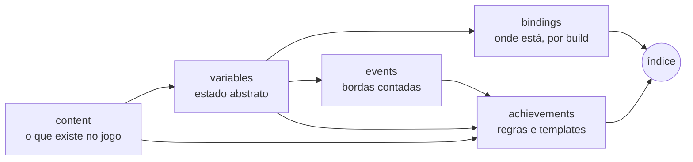

# Modelo de definição de jogo (schema v2)

Cada jogo é **um arquivo JSON**, `games/<id>.json`. Não existe código por jogo: o motor lê a definição, **indexa** o conteúdo em endereços de memória (ou caminhos de save) e passa a observar só o que as conquistas usam.

O catálogo carrega todo `games/*.json` e escolhe o jogo pelo Title ID do processo e o binding pelo Build ID. A estrutura é estrita: chaves fora do padrão são rejeitadas por `python3 tools/sa.py validate`. O schema [`schema/game-definition.schema.json`](../schema/game-definition.schema.json) descreve a mesma estrutura para o editor. Para criar um jogo novo, veja [adicionar-um-jogo.md](adicionar-um-jogo.md).

Jogos da v1:

| Jogo | Fonte | Definição |
|---|---|---|
| Mario Kart 8 Deluxe | memória (`dmnt:cht`) | [`games/mario_kart_8_deluxe.json`](../games/mario_kart_8_deluxe.json) |
| The Legend of Zelda: Link's Awakening | memória (`dmnt:cht`) | [`games/zelda_links_awakening.json`](../games/zelda_links_awakening.json) |
| Ship of Harkinian (OoT) | save JSON | [`games/ship_of_harkinian.json`](../games/ship_of_harkinian.json) |

## 1. As cinco camadas



| Camada | Pergunta que responde | Muda quando |
|---|---|---|
| `content` | Quais copas, itens, masmorras, chefes existem, e **qual a chave de cada um na memória** (`slot`, `bit`, `value`, `index`) | Nunca, salvo DLC |
| `variables` | Que estado o jogo tem (`rupees`, `p1.star_timer`, `dungeon.treasures`), com tipo | Raramente |
| `bindings` | Onde cada variável está **naquele build** (região + offset, cadeia de ponteiros ou caminho no save) e com que confiança | A cada atualização do jogo |
| `events` | Momentos ("usou estrela", "venceu corrida"), detectados como borda de subida e contados para sempre | Raramente |
| `achievements` | Regras sobre variáveis, contadores e conteúdo | Quando quiser |

A separação é o ponto principal: **uma atualização do jogo só exige um novo binding**. Conteúdo e conquistas ficam iguais.

## 2. Conteúdo indexado

O conteúdo carrega a chave que o jogo usa internamente. Exemplo (Link's Awakening):

```json
"content": {
  "dungeons": [
    { "id": "tail_cave",     "name": { "pt-BR": "Caverna da Cauda", "en": "Tail Cave" },     "slot": 0 },
    { "id": "bottle_grotto", "name": { "pt-BR": "Gruta da Garrafa", "en": "Bottle Grotto" }, "slot": 1 }
  ]
},
"variables": {
  "dungeon.treasures": { "type": "u8", "indexed_by": "dungeons" }
}
```

Uma variável `indexed_by` vira **uma instância por item do conteúdo**. No binding, `index_key` diz qual campo do item usar e `stride` diz a distância entre entradas:

```json
"dungeon.treasures": { "base": "main", "offset": "0x1CBB301", "stride": "0x10", "index_key": "slot", "confidence": "community" }
```

O indexador gera `dungeon.treasures[tail_cave]` em `main+0x1CBB301`, `dungeon.treasures[bottle_grotto]` em `main+0x1CBB311`, e assim por diante. Item sem a chave fica `to_discover`.

Para saves, o mesmo vale com caminhos: `"path": "stats.itemTimestamps[{item.timestamp_index}]"`.

## 3. Conquistas declarativas e templates

Uma conquista é uma condição sobre variáveis (`"value"`), contadores de eventos (`{"count": "star_used"}`) e constantes:

```json
{ "id": "star_50", "name": "Constelação", "description": "...", "rarity": "rare",
  "condition": { "value": { "count": "star_used" }, "op": ">=", "rhs": 50 } }
```

Operadores: `== != < <= > >= has_all has_any`. Agrupadores: `all`, `any`, `not`, `exists`. Valores: `var`, `count`, `popcount`, `sum`, `div`, `truth`.

**Templates** geram uma conquista por item do conteúdo, com placeholders `{item.campo}`:

```json
{ "id": "dungeon_treasures", "for_each": "dungeons",
  "name": { "pt-BR": "Tesouros: {item.name}", "en": "Treasures: {item.name}" },
  "condition": { "value": "dungeon.treasures[{item.id}]", "op": "has_all", "rhs": "0x0F" } }
```

Isso gera `dungeon_treasures.tail_cave`, `dungeon_treasures.bottle_grotto`, etc. `where_has: "bit"` filtra só os itens que têm aquele campo.

Agregados sobre o conteúdo, usados com `{each.campo}`:

| Construção | Vira |
|---|---|
| `{"content_mask": {"of": "figures"}}` | OR dos `mask` de todos os itens (ou os de `key`) |
| `{"for_all": "cups", "condition": ...}` | `all` com uma cópia da condição por item |
| `{"for_any": "cups", "condition": ...}` | `any` idem |
| `{"count_of": "cups", "condition": ...}` | `sum` de `truth` por item, útil para progresso |

Uma condição simples `{count: e} >= N` ganha barra de progresso automaticamente.

## 4. Confiança e prontidão

Nenhum endereço é inventado. Cada variável no binding declara de onde veio:

| Confiança | Significado | Efeito |
|---|---|---|
| `verified` | Confirmado no console com o build ID | conquista **ativa** |
| `community` | Publicado em cheats/fóruns (com fonte em `note`) | conquista **ativa** |
| `assumed` | Dedução (ex.: valor de item ausente no cheat) | **ensaio**: avalia e registra, mas não desbloqueia nem notifica |
| `to_discover` | Ainda não achado; `note` traz a dica de busca (Breeze/EdiZon) | **a descobrir**: não é avaliada |

A prontidão de cada conquista é o **mínimo** entre as variáveis que ela usa (inclusive as do `active_when` e dos eventos referenciados) e a confiança dos itens de conteúdo que a geraram. O comando `index` mostra o motivo (`<- p1.coins: endereço a descobrir`).

O modo ensaio permite publicar uma definição incompleta sem risco de desbloqueio falso: quando alguém confirmar o endereço no console, basta trocar `assumed` por `verified`.

## 5. O índice e o plano de leitura

`build_index(definição, binding)` produz:

1. **Instâncias**: cada variável (e cada item de variável indexada) com região ou ponteiro, offset, tipo e confiança.
2. **Prontidão** por conquista e os bloqueios.
3. **Plano de leitura**: as instâncias usadas são agrupadas por âncora (região ou ponteiro) em blocos contíguos (vão de até 0x40 bytes, bloco de até 0x1000). Cada tick faz uma leitura por bloco, mais uma por nível de cada ponteiro.

| Jogo | Variáveis observadas | Leituras por tick |
|---|---|---|
| Link's Awakening | 23 (rúpias, troca, figurinhas, folhas, 18 de masmorras) | 2 blocos (130 e 106 bytes) |
| Mario Kart 8 Deluxe | 6 do kart do P1 | 1 bloco de 144 bytes + 2 derreferências |

## 6. Bindings de memória

```json
{
  "id": "build_FE941ED5BA14BE5D",
  "source": "memory",
  "match": { "build_ids": ["FE941ED5BA14BE5D"] },
  "pointers": { "p1_kart": { "base": "main", "chain": ["0x1354AF0", "0x6E0"] } },
  "active_when": { "exists": "p1.star_timer" },
  "variables": {
    "p1.star_timer": { "from": "p1_kart", "offset": "0x7BC", "confidence": "community" }
  }
}
```

- O binding é escolhido pelo **build ID** do módulo principal (`dmntchtGetCheatProcessMetadata`), comparado sem diferenciar maiúsculas. Sem binding para o build, o jogo fica sem suporte, e nada é lido.
- `base` é uma região (`main`, `heap`, `alias`, `aslr`); `from` é um ponteiro. A cadeia `[[main+0x1354AF0]+0x6E0]` lê um u64 em cada nível; ponteiro nulo ou fora das regiões do processo torna a variável ausente. Em jogos AArch32 (ex.: Mario Kart 8 Deluxe até a 3.0.3), declare `"pointer_width": 4` no binding para ler u32 por nível.
- `active_when`: fora do estado ativo (ex.: menu, sem kart), os eventos não contam e as conquistas não são avaliadas. Isso evita contar lixo de memória.
- Os offsets vêm do formato de cheats do Atmosphère: `58020000 X` / `58021000 Y` é a cadeia de ponteiros; `0TMR00AA AAAAAAAA` com M=0 é endereço estático em `main`.

## 7. Eventos

```json
{ "id": "star_used", "when": { "value": "p1.star_timer", "op": ">", "rhs": 0 } }
```

O evento conta quando a condição passa de falsa para verdadeira (borda de subida). O contador é persistido no estado do usuário, por jogo, e sobrevive entre sessões, por isso "Use 50 Superestrelas" funciona mesmo que o jogo não guarde esse número.

## 8. Testar no PC

```bash
# relatório do índice: variáveis, ponteiros, plano de leitura, prontidão
python3 tools/sa.py index zelda_links_awakening

# reproduz um trace de memória simulada tick a tick
python3 tools/sa.py replay mario_kart_8_deluxe examples/traces/mk8_corrida.json --verbose

# saves do SoH
python3 tools/sa.py save ship_of_harkinian --save-dir examples/soh/Save
```

Formato do trace: `{"build_id", "regions": {"main": {"base", "size"}}, "initial": [escritas], "ticks": [{"label", "writes": [{"addr": "main+0x1CC0760", "type": "u16", "value": 999}]}]}`.

## 9. Como completar uma definição no console

1. Abra o jogo e confira o build ID no EdiZon ou no Breeze. `python3 tools/sa.py detect <title_id> <build_id>` diz se ele já tem binding. Se não tiver, copie o binding mais próximo e marque tudo como `assumed` até confirmar.
2. Para cada variável `to_discover`, siga a dica em `note`: busca de valor exato, mude o valor no jogo, refine. Para estruturas no heap, ache a cadeia de ponteiros a partir de `main`.
3. Registre o offset e mude a confiança. Rode `sa.py index` para ver as conquistas passarem de "a descobrir" para "ativa".
